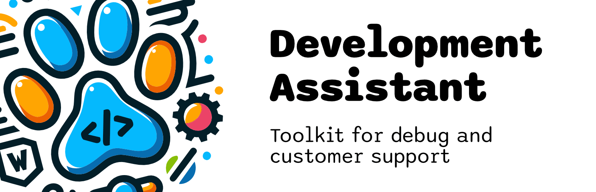

# Development Assistant



Development Assistant is an open-source WordPress plugin that brings practical
debugging and customer-support tools into the WordPress admin area. It helps site
owners, developers, and support teams diagnose problems without repeatedly
editing configuration files or assembling temporary troubleshooting workflows
by hand.

[WordPress.org](https://wordpress.org/plugins/development-assistant/) ·
[Support](SUPPORT.md) · [Report a bug](https://github.com/dpripa/development-assistant/issues) ·
[Security](SECURITY.md)

## What It Does

- **Manage WordPress debugging:** Enable and inspect `WP_DEBUG`, `WP_DEBUG_LOG`,
  and `WP_DEBUG_DISPLAY` from the admin interface. Configuration changes are
  validated, backed up, and rolled back when they cannot be verified.
- **Work with the debug log:** Review, download, clear, and protect the WordPress
  debug log without reaching for server tools for every support session.
- **Create temporary support access:** Create a support user, choose when it
  expires, copy its credentials, or share access by email with an optional
  message.
- **Isolate plugin conflicts:** Temporarily deactivate plugins during diagnosis
  and restore their previous activation state when troubleshooting is complete.
- **Download installed plugins:** Download plugin packages directly from the
  Plugins screen for inspection, testing, or transfer to a sandbox.
- **Restore the original state:** Reset Development Assistant data and restore
  the debug configuration and temporary plugin state managed by the plugin.

## Plugin Download Exclusions

In Development Assistant settings, **Plugins Screen → Exclude from plugin
downloads** controls which files and folders are omitted from installed-plugin
ZIP downloads. Enter one literal name or plugin-relative path per line:

```text
node_modules
.DS_Store
assets/source/
config/local.json
```

The initial default list is:

```text
node_modules
.git
.svn/
.hg/
.idea/
.vscode/
.DS_Store
Thumbs.db
desktop.ini
__MACOSX/
.phpunit.cache/
.phpunit.result.cache
.eslintcache
.stylelintcache
.sass-cache/
npm-debug.log
yarn-debug.log
yarn-error.log
.pnpm-debug.log
```

These entries cover development dependencies, version-control metadata, editor
settings, operating-system metadata, and development-tool caches and logs.
Existing saved lists, including an empty list or the previous `node_modules`
list, are preserved; the expanded default applies when no list has been saved.

Bare names match complete names at any depth; paths containing a slash match
from the plugin root. A trailing slash matches folders only, including their contents. Matching is case-sensitive and
supports literal entries, without wildcards or regular expressions. Blank lines
and duplicates are ignored, and backslashes are normalized to forward slashes.
Absolute paths and `.` or `..` path segments are rejected; the previous list is
kept if the input is invalid.

The saved list applies to all plugin downloads. Remove entries or save an empty
list to include everything. Installed files are unchanged. If a rule would omit
the selected plugin's main PHP file, the download fails with an explanatory
notice. Runtime dependencies and compiled assets are included unless you exclude
them explicitly.

## Designed for Safer Troubleshooting

Development Assistant treats changes to `wp-config.php` and `.htaccess` as
recoverable operations. It checks whether the host permits modification, keeps
protected recovery data, verifies writes, and rolls back failed changes instead
of reporting success prematurely.

The plugin also distinguishes temporary support state from permanent WordPress
configuration so deactivation and reset behavior remain explicit and
predictable.

## Requirements

- WordPress 5.0 or later
- PHP 7.4 or later

## Installation

Install **Development Assistant** from **Plugins → Add New** in WordPress, or
download it from the official
[WordPress.org plugin page](https://wordpress.org/plugins/development-assistant/).
Versioned release archives, including prereleases, are also available from
[GitHub Releases](https://github.com/dpripa/development-assistant/releases).

To install a downloaded archive manually, open **Plugins → Add New → Upload
Plugin** in WordPress and upload the ZIP file.

After activation, open the Development Assistant settings in the WordPress admin
area and enable only the tools needed for the current troubleshooting session.

With JavaScript enabled, **Save Changes** is rendered disabled from the start
and becomes available only when the form differs from its initial values.
Reverting all changes disables it again. The button
also stays disabled while submitting to prevent duplicate requests. Returning
with the browser's Back button re-evaluates whether the form has changes.
WordPress displays settings validation errors on
the returned page. If the browser reports that it is offline, the form displays
a connection error and remains available to retry. Other navigation failures
use the browser's error page; return with Back to retry. Saving also works
without JavaScript, with the browser's standard submission behavior.

## Help and Feedback

- Use the [WordPress.org support forum](https://wordpress.org/support/plugin/development-assistant/)
  for installation, configuration, and usage questions.
- Use [GitHub Issues](https://github.com/dpripa/development-assistant/issues) for
  reproducible bugs and focused feature proposals.
- Report suspected vulnerabilities privately according to
  [SECURITY.md](SECURITY.md).

## Contributing and Project Documentation

Start with [CONTRIBUTING.md](CONTRIBUTING.md) before proposing a change. The
following documents define the development and project-maintenance rules:

- [Development environment and commands](docs/DEVELOPMENT.md)
- [Architecture](docs/ARCHITECTURE.md)
- [Release policy](docs/RELEASE_POLICY.md) for verified release maintainers
- [Code of Conduct](CODE_OF_CONDUCT.md)
- [Support policy](SUPPORT.md)
- [Security policy](SECURITY.md)

## License

Development Assistant is licensed under
[GPL-2.0-or-later](license.txt).

## Mail Health

Open **DevAssistant → Mail Health** and turn on **Enable mail monitoring**.
Click **Save Changes**, as on the other settings pages. The plugin runs a background check immediately after enabling,
then checks hourly using the site's existing mail configuration and administrator
email address. The page updates its status automatically; there are no recipient,
timing, timeout, test-code, or manual-retest controls. The same form also works without JavaScript.

The page shows a short sending status, the last check time, and a readable reason
when something fails. Temporary sending failures are retried automatically.
If evidence becomes older than two hours or scheduled work stops running, the
plugin shows an uncertain or delayed status. A check that has not started within
30 seconds is reported as delayed; it is not left indefinitely checking. Administrators also see persistent
notices for failures and stale results. Turning monitoring off stops observation,
scheduled tests, and notices.

Test emails are real messages to the WordPress administrator address; enabling
monitoring may incur provider charges. The site needs a working WordPress cron
runner. A successful send proves acceptance by the mail service, not receipt or
Inbox placement. Queued, suppressed, or unsupported mailers remain unconfirmed.
No external inbox service, tracking pixels, or delivery-confirmation setup is used.
The local Docker bootstrap installs a development-only cron loopback helper so
container requests reach the local WordPress server rather than the host HTTPS
port. The browser continues to use HTTPS.

Diagnostics store fixed error categories without customer messages, credentials,
or raw provider responses. History is bounded to 20 events and seven days.
Deactivation clears scheduled jobs; the existing reset setting controls retained
configuration. Changed administrator email or mail settings trigger a fresh check.
Detected changes to site URL/environment disable inherited monitoring on clones.
Local Mailpit capture is not proof of production delivery.

Mail failures include a specific cause, its effect on sending, and a **What to
check** action. For example, an invalid From address is identified as WordPress
validation stopping the email before submission to the mail service. SMTP
connection, authentication, TLS, quota, rate-limit, and cron problems have their
own guidance; unknown failures remain explicitly unidentified. Administrator
notices include the diagnosis and next action too.

Only a bounded address-shaped From value from the plugin's own test may be kept
for this diagnosis. Sender addresses from ordinary site messages, message bodies,
credentials, and raw provider responses are excluded. A confirmed successful
probe clears the old diagnostic. These messages add no configuration controls.
